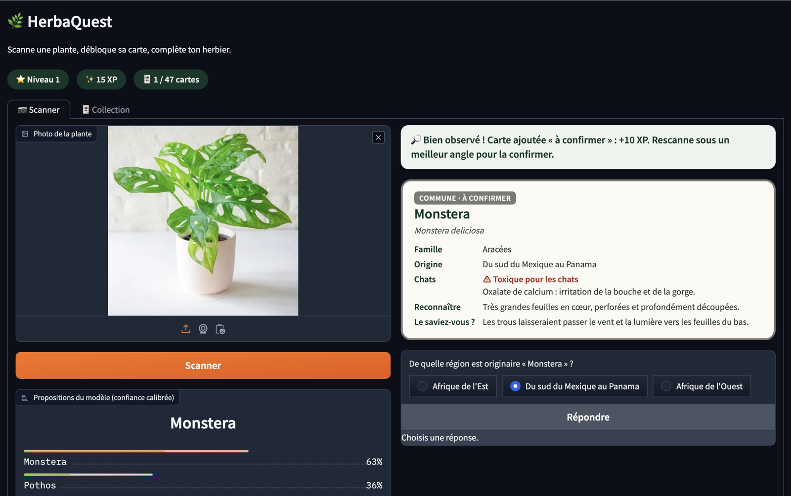
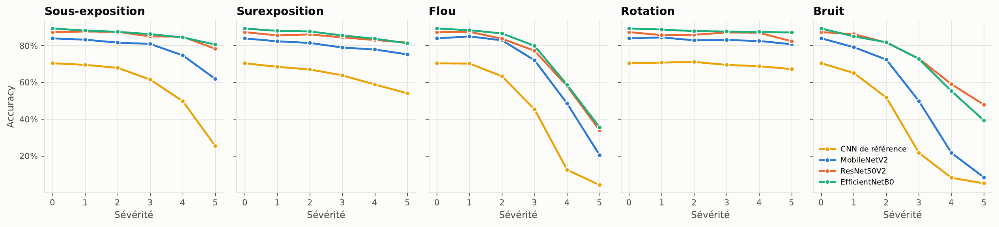
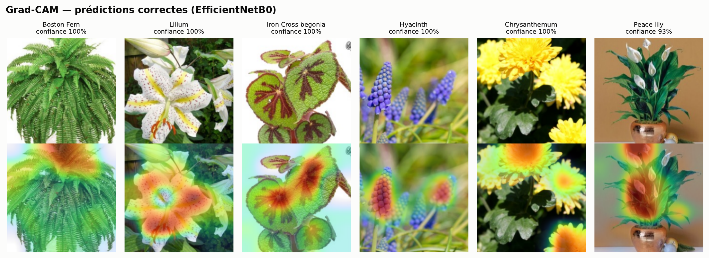
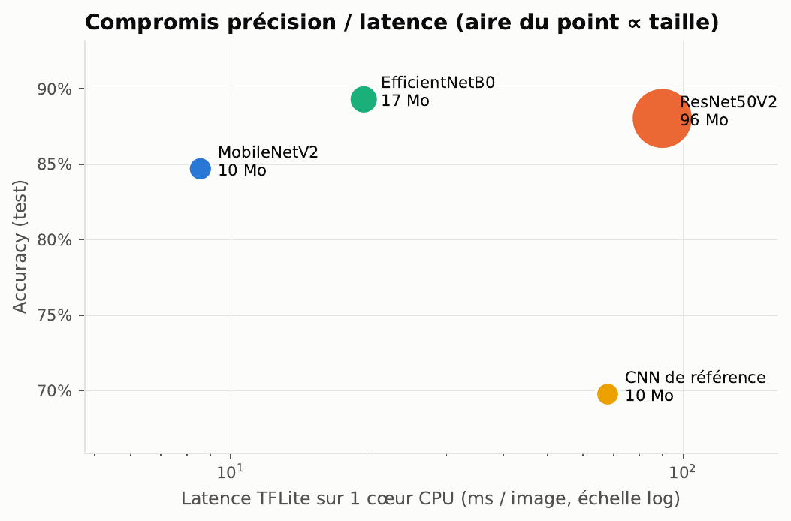
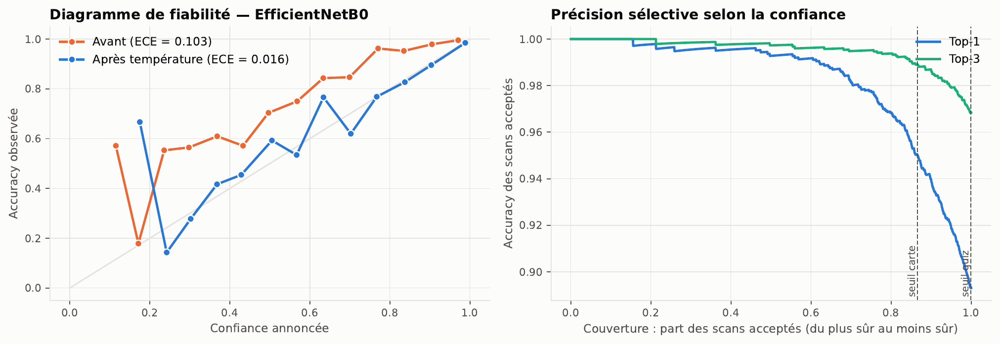

# 🌿 HerbaQuest

**Scanne une plante, débloque sa carte, complète ton herbier.**
Reconnaissance de 47 espèces de plantes par deep learning, pensée pour la réalité augmentée éducative sur mobile.

> Projet de Master — *Ingénierie & Analytique des Données Appliquées à l'Industrie du Gaming* (IADAIG),
> ENS de Fès, Université Sidi Mohamed Ben Abdellah — Module Deep Learning 2026/2027.
> **Ibtissam Draoui · Aya Laazizi · Majda Bakhari**



## L'idée en trois lignes

1. **Un classifieur** compare quatre architectures (CNN de zéro, MobileNetV2, ResNet50V2, EfficientNetB0) sur trois axes : précision, robustesse aux conditions de prise de vue, latence embarquée.
2. **Une confiance fiable** : le modèle est calibré (mise à l'échelle en température), puis sa confiance décide de ce qui se passe dans le jeu.
3. **Un jeu** : confiance élevée → carte débloquée ; confiance moyenne → quiz d'observation entre trois espèces ; confiance faible → « rescanne ». L'erreur du modèle devient un moment d'apprentissage.

## Résultats

Évaluation sur 2 216 images de test (47 classes), après un nettoyage qui retire les doublons **avant** le découpage.

| Modèle | Paramètres (M) | Accuracy | F1 macro | Top-3 | Accuracy dégradée | Latence CPU (ms) | Taille TFLite (Mo) |
|---|---|---|---|---|---|---|---|
| **EfficientNetB0** (retenu) | 4,4 | **89,3 %** | **88,5 %** | **96,8 %** | **79,1 %** | 19,7 | 17,4 |
| ResNet50V2 | 24,1 | 88,0 % | 86,7 % | 96,4 % | 78,4 % | 89,9 | 96,2 |
| MobileNetV2 | 2,6 | 84,7 % | 83,8 % | 94,9 % | 69,3 % | 8,6 | 10,2 |
| CNN entraîné de zéro | 2,4 | 69,8 % | 69,9 % | 87,7 % | 51,3 % | 68,1 | 9,7 |

*Accuracy dégradée : moyenne sur 5 dégradations (exposition, flou, rotation, bruit) × 5 niveaux. Latence : TensorFlow Lite, 1 cœur CPU.*

- EfficientNetB0 et ResNet50V2 ne diffèrent pas significativement (test de McNemar, p = 0,075), mais EfficientNetB0 est **4,6 fois plus rapide et 5,5 fois plus léger**.
- Après calibration par température, l'erreur de calibration passe de **10,3 % à 1,6 %**.
- Dans le jeu, **86,6 %** des scans débloquent une carte, et **95,0 %** de ces cartes sont justes.

| | |
|---|---|
|  |  |
|  |  |

## Ce que contient le dépôt

```
HerbaQuest_notebook.ipynb   Pipeline complet : EDA → prétraitement → modèles → évaluation → export
app/
  app.py                    Application Gradio (scanner, cartes, XP, quiz, collection)
  plant_cards.json          47 fiches pédagogiques
  requirements.txt
  export/                   Modèle TFLite de la démo + métadonnées (produits par le notebook)
paper/
  paper.tex                 Article IEEE double colonne, 3 pages
  paper_assets/             Chiffres et figures injectés automatiquement (produits par le notebook)
figures/                    Principales figures de l'évaluation
docs/                       Capture de l'application
```

## Reproduire

**1. Entraînement (Kaggle, GPU gratuit)**

1. Créez un notebook Kaggle et importez `HerbaQuest_notebook.ipynb`.
2. *Add Input* → dataset **House Plant Species** ; *Accelerator* → **GPU T4** ; *Internet* → **On**.
3. Lancez d'abord avec `QUICK_RUN = True` (vérification en quelques minutes), puis `QUICK_RUN = False`.
4. Dans l'onglet *Output*, téléchargez `herbaquest_export.zip`, `herbaquest_paper_assets.zip` et `herbaquest_figures.zip`.

**2. Application (en local)**

```bash
cd app
python3 -m venv .venv && source .venv/bin/activate
pip install -r requirements.txt
python app.py          # puis ouvrir http://127.0.0.1:7860
```

Le modèle de la démo (`app/export/model.tflite`) est inclus dans le dépôt. Les autres modèles se régénèrent avec le notebook.

**3. Article** : décompressez `herbaquest_paper_assets.zip` dans `paper/paper_assets/`, puis compilez `paper.tex` (pdfLaTeX, par exemple sur Overleaf).

## Méthode

| Étape | Choix | Pourquoi |
|---|---|---|
| Audit des données | Dimensions, luminosité, netteté, empreintes MD5 et dHash pour chaque image | Images du Web : il faut mesurer le bruit avant d'entraîner |
| Nettoyage | Doublons et étiquettes contradictoires retirés **avant** le découpage | Éviter la fuite entre entraînement et test |
| Découpage | 70 / 15 / 15 stratifié, perte pondérée | Classes déséquilibrées |
| Augmentation | Recadrage, miroir horizontal, rotation, zoom, luminosité, contraste, saturation | Chaque transformation simule un vrai scan au téléphone |
| Modèles | Transfert en deux phases (tête seule, puis 30 % des couches hautes) | Ne pas détruire les poids ImageNet |
| Hyperparamètres | Optuna (TPE + élagage médian) | Recherche efficace à budget GPU limité |
| Évaluation | F1 macro, top-3, AUC, IC bootstrap, test de McNemar | Mesurer aussi l'incertitude des résultats |
| Explicabilité | Grad-CAM, erreurs les plus confiantes | Vérifier que le modèle regarde la plante |
| Robustesse | 5 dégradations × 5 sévérités | Conditions réelles d'un scan |
| Calibration | Température + seuils choisis sur la validation | Une confiance fiable pour piloter le jeu |
| Embarqué | TensorFlow Lite, version quantifiée | Latence et taille sur mobile |

## Limites

- Images collectées sur le Web, pas de vrais scans en réalité augmentée.
- Étiquettes non validées par des botanistes.
- Hyperparamètres cherchés sur une seule architecture, une seule graine d'entraînement.
- Latence mesurée sur un CPU de serveur, pas sur un téléphone.
- Les informations de toxicité des fiches sont indicatives et ne remplacent pas un avis vétérinaire.

## Données et licence

Le dataset *House Plant Species* (Kaggle) est distribué sous licence **non commerciale** : ce dépôt ne le redistribue pas, et le modèle entraîné ne doit pas être utilisé à des fins commerciales. Le code de ce dépôt est sous licence MIT.

## Références principales

Sandler et al., *MobileNetV2*, CVPR 2018 · He et al., *Identity Mappings in Deep Residual Networks*, ECCV 2016 · Tan & Le, *EfficientNet*, ICML 2019 · Selvaraju et al., *Grad-CAM*, ICCV 2017 · Guo et al., *On Calibration of Modern Neural Networks*, ICML 2017 · Hendrycks & Dietterich, *Benchmarking Neural Network Robustness*, ICLR 2019 · Akiba et al., *Optuna*, KDD 2019.
